# Sloop Go

A native Android app (Kotlin + Jetpack Compose) for the **M-VAVE FM-1** running the **SLOOP** firmware.
It talks to the device directly over USB-MIDI through Android's `MidiManager` — no WebView, no JavaScript bridge —
so edits reach the FM-1 immediately.
Every release is tested on my own phone, connected to my own FM-1 running the latest SLOOP firmware, before being published. But it may still contain bugs.

<table>
  <tr>
    <td>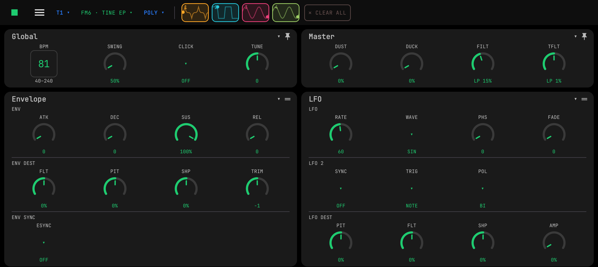</td>
    <td>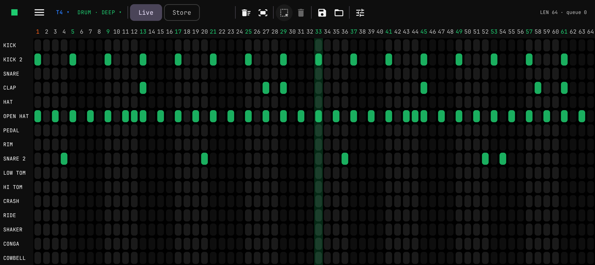</td>
    <td>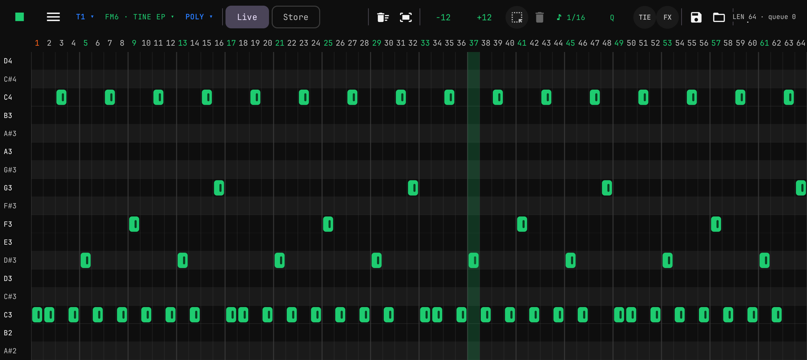</td>
  </tr>
  <tr>
    <td>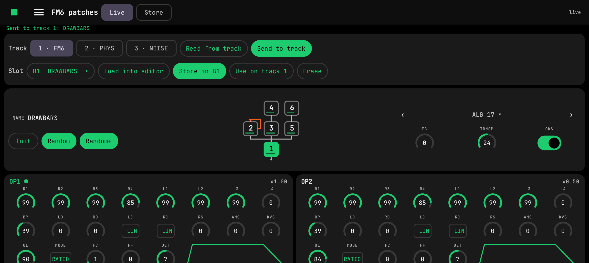</td>
    <td>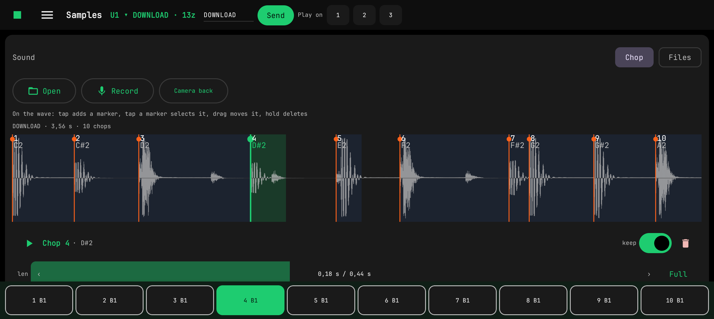</td>
    <td>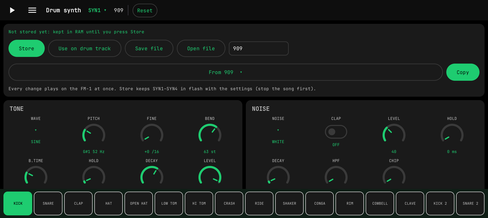</td>
  </tr>
  <tr>
    <td>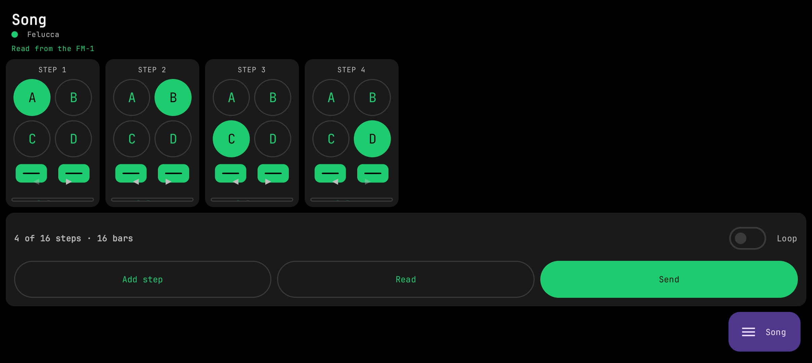</td>
    <td>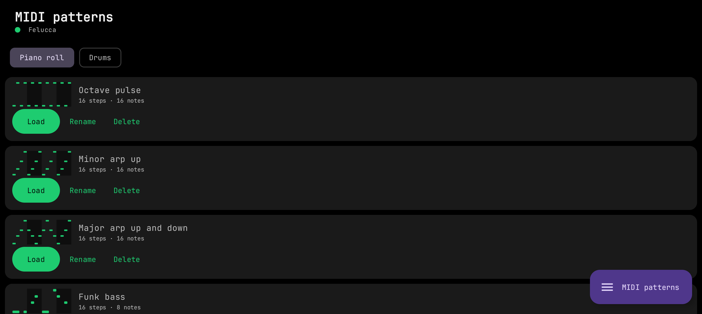</td>
    <td>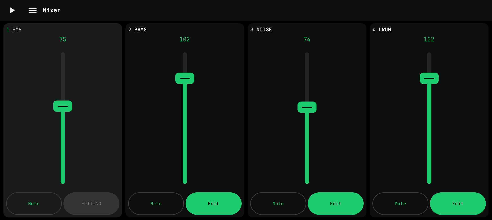</td>
  </tr>
  <tr>
    <td>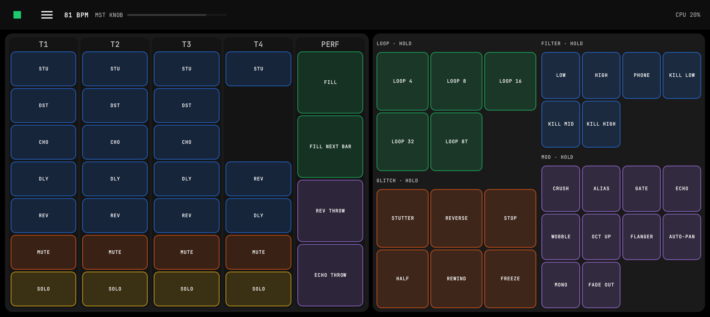</td>
    <td>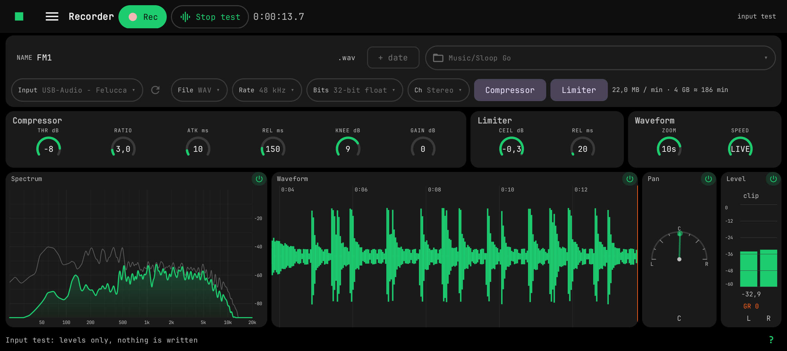</td>
    <td></td>
  </tr>
</table>

## Install on your phone

**⬇ [Download sloop_go_1.7.25.apk](https://github.com/jahlib/sloop-fm1-go/releases/download/1.7.25/sloop_go_1.7.25.apk)**
— other versions live on the [Releases](https://github.com/jahlib/sloop-fm1-go/releases) page.

0. You need an **M-VAVE FM-1** device with the latest [**SLOOP** firmware](https://github.com/isod89/sloop-fm1)
   already installed — the app is only an editor for it and does nothing without the device.
1. Open the link **on the phone** and download the file. The browser may warn that APKs "might be harmful" —
   this is a self-signed dev build, so the warning is expected; keep the file.
2. Tap the downloaded file and allow installing apps from this source when Android asks.
3. **Google Play Protect will flag the app** — it is a development build signed with a debug key, not a Play Store
   release, so the scanner does not know it. Tap **"Install anyway"** (or **More details → Install anyway**) if you
   trust it; if you do not, simply do not install — building the APK from this repository yourself gives you the
   same app.
4. Connect the FM-1 to the phone over USB, open **Sloop Go**, tap **Find MIDI device** and grant USB access.

**Updates:** on launch the app checks the latest GitHub release (tag = version); when it is newer than the installed
build it offers to download the attached APK and starts the system installer. Android asks once to allow installs
from Sloop Go. The **Updates** block at the bottom of the **Device** page runs the check by hand.

> **Made on the basis of the work of others.** Sloop Go is a companion app developed for
> [**SLOOP**](https://github.com/isod89/sloop-fm1) by **isod89**, which in turn builds on
> [**Felucca**](https://github.com/hugelton/Felucca) by **Leo Kuroshita / Hügelton Instruments**.
> The editor protocol, the FM6 patch format and the firmware itself are their work — this app would not
> exist without them. See [NOTICE.md](NOTICE.md).

## Features

- **Sound** — all sound parameters in collapsible blocks with touch knobs, engine / kit and preset pickers, track selector.
  SLOOP 2.6 adds the per-track INSERT effect, LFO 2 (SYNC / TRIG / POL), ENV SYNC (note values for ATK / DEC / REL),
  ANALOG's filter TYPE, and the global MIDI (channel per track) and TEXTURE blocks; the INSERT values can be locked on a step.
  SLOOP 2.7 adds GLO > MIDI 3 (FX CH, DR MAP, REMOTE, CLOCK) and, on the drum track, every drum sound's TUNE and DECAY.
- **Live** (SLOOP 2.7) — per-track mute / solo with level meters, FILL, REV / ECHO THROW, the master level and the 27
  punch-in effects played while a pad is held; TAP tempo and the device's real play state.
- **Sequencer** — drum grid and synth piano-roll with pinch zoom and a single icon toolbar, Live / Store (draft)
  modes, voice modes, step nudge / fill / parameter locks (SLOOP 2.4); **Select** mode in the piano roll and the drum
  grid (frame-select — or just hold empty space in the piano roll, drag the whole figure, stretch them all by one
  note's edge, hold to clone it, existing notes win on overlap), ±12 transpose with auto-fit (only the selected notes
  in Select mode); in the drum grid **hold a lane name** (e.g. KICK) and drag it onto another lane to move all of its
  hits at once (kick → kick 2, open hat → closed hat…); the note names on the left (piano roll) and the lane names
  (drum grid) light up while the FM-1 sounds them — keys pressed on it, or the sequencer's with MIDI OUT = SEQ;
  **Save / Load** of note
  patterns as MIDI files kept inside the app (separate piano-roll and drum lists with previews; tap to load, or hold
  one and drag it onto the piano roll; 30 ready drum and 40 ready piano patterns included, many of them 32 or 64 steps —
loading a longer clip grows the pattern length to fit it). Only the notes are stored,
  never the sound or knob positions. A **MIDI patterns** page renames, deletes and loads them onto any track.
- **FM6 patches** (SLOOP 2.4) — slot library, DX7 SysEx import / export from phone storage, upload to the bank or to a
  track, and a full six-operator editor. The chosen **algorithm is drawn as the usual FM chain**: operator boxes with
  each modulator above what it modulates, carriers filled and joined by the output line, the feedback loop in orange,
  a level bar in every box; tap a box to jump to its operator card, step through the 32 algorithms or pick one from a
  picture grid. The six operator cards are compact (three rows of eight knobs, the envelope sketched in the free slots)
  and sit two or three to a row, with the LFO and pitch EG side by side; double-tap a knob to restore the init value.
  **Live / Store** like in the sequencer: Live sends every change to the track at once, Store keeps edits on the phone
  until **SEND**, which sits next to the menu button in the pinned top-left cluster so it is always in reach.
- **Display density** — knobs are sized from the screen's room in dp, not its pixels: a high-density or zoomed display
  gets smaller knobs so as much as possible still fits (the FM6 page packs them tightest), and a big screen never gets
  bigger ones.
- **Drum synth** (SLOOP 2.5) — the four synthesised kits SYN1–SYN4 in Sound-style knob blocks, heard while editing. A pinned top bar holds play/stop, the menu, the SYN picker, the
  kit name and Reset; the 16 sound pads are pinned along the bottom — hold a pad to hear your knob edits —
  the knobs scroll between.
- **Song** (SLOOP 2.5) — vertical step cards: A–D section buttons, Bars / Times steppers, move and delete, loop,
  one-tap Add step, read / send.
- **Samples** (SLOOP 2.4) — USR1–4 user sample slots (a dropdown shows the picked one). Load audio files from phone
  storage **or record straight from the mic** (camera / voice / raw inputs selectable — and, with the cable in, the
  FM-1's own USB sound, listed as "USB · " and the device's name: it is read as stereo, mixed to mono and resampled, so the FM-1 can
  resample itself) and drop the take into the slot: **Chop** mode (the default) cuts one take into pieces on a touch waveform — the chop keys sit on a pinned
  bottom strip, markers snap to hits, drag to move, per-chop keep / length, auto-fit to the slot; **Files** mode maps
  each file to its note (root from the file name, the rest of the keyboard splits itself). Everything
  is normalized, resampled to 22050 Hz and encoded to IMA ADPCM in-app, then written to the FM-1 over the editor
  protocol with progress — ready to play via SAMPLE on a track.
- **Mixer** — vertical channel strips with faders, Mute and Edit. They fill the whole height under the pinned top bar,
  so the faders stay in reach however dense the display or large its size setting is.
- **Recorder** — records the FM-1's USB audio out (the master, the same stream a computer records in a DAW) into WAV
  or lossless FLAC files on the phone: 44.1 / 48 kHz, 16-bit or 24-bit (WAV also 32-bit float), stereo or mono, saved to Music/Sloop Go or any
  folder you pick. The page fits one screen: file name and destination on top with the format as short dropdowns
  beside them, and one row of displays: a **spectrum analyzer** (log frequency, filled smooth curve and a falling peak
  line, in the style of an EQ plugin's analyzer), a compact scrolling waveform of the take (a DJ-app style
  overview) whose **ZOOM** (10 ms to a minute across the width: look at the wave itself, or at the whole take) and
  **SPEED** (live, or slow motion behind the live edge) are knobs beside the compressor's and the limiter's, a **pan half-circle** showing where the sound sits between left and right right now (a
  needle, a wedge and a one-second trail) and a vertical level meter with clip hold. Each display has a small power
  button in its header that switches it off and on: an off display is dimmed and costs no analysis or drawing, an input test that only meters (it also starts by itself while the FM-1 plays, once the microphone permission is
  given, and ends with the playback), Share for the last take. The name is used as
  typed (switch on "+ date" for a new file each time); if a file of that name is already there, Rec asks before
  replacing it. A **Compressor** (threshold, ratio, attack, release, knee, make-up gain) and a look-ahead **Limiter**
  (ceiling, release) can be switched in before the file: their knobs appear in blocks under the settings, the meters,
  the waveform and the file all show the processed sound, and a GR readout shows how far they pull the level down. The
  page scrolls when the blocks do not fit. A take goes on while you switch pages; closing the app stops it and keeps the file.
- **Device** — connection and firmware info. Play / Stop and the page menu are pinned in the top-left corner of every
  page and wake up once the FM-1 is connected. The **Interface** block at the bottom sets the theme: follow the phone,
  or keep the app dark or light; the choice is remembered across restarts.
- **Undo / redo** — the first row of the page menu. Every edit (knobs, mixer, steps and notes, per-step nudge / fill /
  locks, FM6 voice, drum synth sounds and kits, song order) is also noted in the phone's RAM; undo sends the earlier
  value through the same request queue as a normal edit. The history is dropped on disconnect, and parts of it when an
  engine / preset swap makes old values meaningless. Flash writes (Store, sample upload / erase) are not undoable.

Requires a phone with USB host (OTG) and a USB-C cable to the FM-1. Follows SLOOP 2.7 (editor protocol v12): the Play / Stop button and the sequencer's playhead follow the FM-1 itself (LIVE);
samples can loop (LOOP, LOOP+TAIL);
features that need newer firmware are hidden or disabled on older SLOOP. Up to date with **SLOOP 2.8.3** — its changes (held
POLY notes that keep sounding under later ones, steadier drum-voice stealing, click-free sample retrigger, second-core hardening)
are firmware playback fixes that keep the same editor protocol (v12) and the SLOOP 2.7 step format, so nothing here had to change:
a note recorded on a 2.8.3 device as a long tail running under a melody reads back in the piano roll as the overlapping bar it is.

## Build

```bash
./build-android.sh            # debug APK
./build-android.sh release    # release APK (signed with the debug key unless you configure your own)
```

Needs JDK 17+ and the Android SDK (platform 34). Details and architecture: [android/README.md](android/README.md).

## License

Copyright (C) 2026 Sloop Go contributors.

This program is free software: you can redistribute it and/or modify it under the terms of the
**GNU General Public License, version 3** as published by the Free Software Foundation. It is distributed in the hope
that it will be useful, but **WITHOUT ANY WARRANTY**; without even the implied warranty of MERCHANTABILITY or FITNESS
FOR A PARTICULAR PURPOSE. See [LICENSE](LICENSE) for the full text.

Writing to a device can overwrite its data: back up your FM-1 first and use this software at your own risk.
